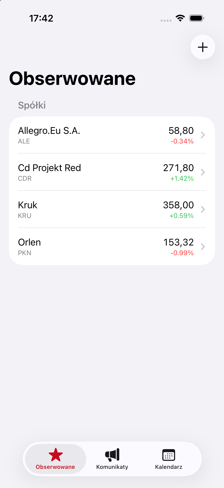
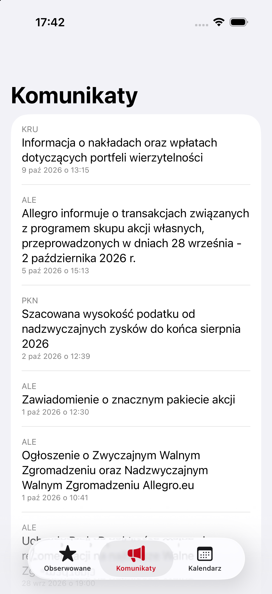
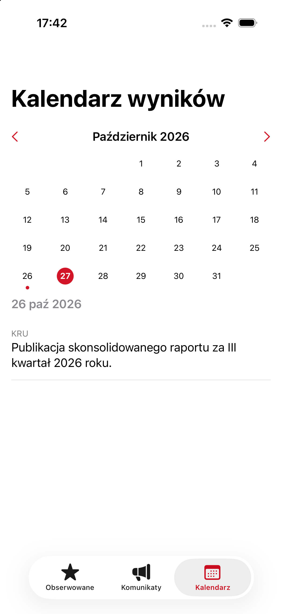
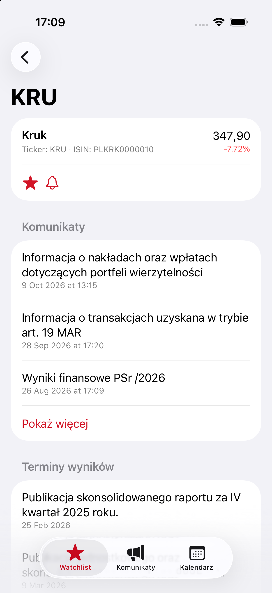

<p align="center">
  
</p>

<h1 align="center">StockPilot</h1>

<p align="center">
  <em>Twoje centrum dowodzenia na giełdzie.</em><br />
  A native iOS companion for investors in Warsaw Stock Exchange (GPW) companies:
  watchlist, ESPI/EBI announcements and an earnings calendar in one place.
</p>

<p align="center">
  
  
  
  
  
</p>

<p align="center">
  
  
  
  
</p>

## Features

- **Watchlist ("Obserwowane").** Pick companies from the full GPW main market (~400 tickers, bundled as a seed) and see live prices and daily change.
- **Announcements feed.** Official ESPI/EBI filings for the companies you follow, newest first, with unread markers and a tab badge.
- **Earnings calendar.** Month view with today highlighted and a list of the selected month's report dates, filled in automatically.
- **Company detail.** Quote, filings and report dates for a single company. Long lists are collapsed to three items with a "Pokaż więcej" toggle.
- **Per-company notifications.** The bell on a company screen turns its notifications on (filled) or off (crossed out) without removing it from the watchlist.
- **Local notifications.** A banner is posted when a refresh finds new filings.
- **Push (backend ready).** Subscription upload and APNs delivery are implemented and gated on credentials, see [Limitations](#limitations).
- **No accounts.** Everything the user picks lives on the device.

## How it works

```
  bankier.pl RSS (ESPI/EBI)      bankier.pl company pages        Yahoo Finance chart API
          |                                |                               |
          v                                v                               |
 +--------------------------------------------------+                      |
 |  Backend (Fastify + node:sqlite)                  |                      |
 |  - cron poller, every 3 min                       |                      |
 |  - name -> ticker matcher                         |                      |
 |  - lazy per-ticker backfill (filings, calendar)   |                      |
 |  - REST API, subscriptions, APNs (optional)       |                      |
 +--------------------------+------------------------+                      |
                            | REST /v1/*                                    |
                            v                                               v
                  +-------------------------------------------------------------+
                  |  iOS app (SwiftUI + SwiftData)                               |
                  |  SwiftData is the source of truth; backend responses are     |
                  |  upserted locally. Quotes are fetched directly from the app. |
                  +-------------------------------------------------------------+
```

The backend exists because push notifications need a process that watches the sources while the app is closed. It stores no user accounts: only the list of companies and a device token with the tickers that device follows.

## Tech stack

### iOS (`ios/`)

| Area | Choice |
| --- | --- |
| Language / UI | Swift, SwiftUI, iOS 17+ |
| Persistence | SwiftData (`Company`, `Announcement`, `CalendarEvent`) |
| Concurrency | async/await, `URLSession` |
| Background work | `BGTaskScheduler` app refresh |
| Notifications | `UNUserNotificationCenter` (local), APNs registration |
| Project generation | [XcodeGen](https://github.com/yonaskolb/XcodeGen) (`ios/project.yml`) |

### Backend (`backend/`)

| Area | Choice |
| --- | --- |
| Runtime | Node.js 25, TypeScript |
| HTTP | Fastify 4 |
| Storage | SQLite via the built-in `node:sqlite` (no native build step) |
| Scheduling | `node-cron` |
| Feeds / scraping | `rss-parser`, `cheerio` |
| Push | APNs over HTTP/2 with ES256 JWT (`jsonwebtoken`) |

## Data sources

| Data | Source | Notes |
| --- | --- | --- |
| New ESPI/EBI filings | `bankier.pl/rss/espi.xml` | Polled every 3 minutes. The feed only keeps the latest ~20-30 items. |
| Filing history | `bankier.pl/gielda/notowania/akcje/{TICKER}/komunikaty` | Scraped lazily the first time a ticker is requested. |
| Report dates | `bankier.pl/gielda/notowania/akcje/{TICKER}/kalendarium` | Scraped lazily; only entries tagged "Wyniki spółek" are kept. Dates come from `data-timestamp`. |
| Quotes | Yahoo Finance chart API, `{TICKER}.WA` | Called from the app, 60 s in-memory cache, degrades quietly when unavailable. |
| Company list | Bundled `companies_seed.json` | 402 companies: ticker, ISIN, full name. |

Filing titles start with the company name, so mapping to a ticker is a normalised exact match with a fuzzy fallback. Entries that do not match are stored with no company instead of being dropped.

## REST API

| Method | Path | Description |
| --- | --- | --- |
| `GET` | `/v1/health` | Liveness check |
| `GET` | `/v1/companies` | Company list |
| `GET` | `/v1/announcements?tickers=A,B` | Filings for the given tickers |
| `GET` | `/v1/calendar?tickers=A,B` | Report dates for the given tickers |
| `GET` | `/v1/companies/:ticker/announcements` | Filings for one company |
| `GET` | `/v1/companies/:ticker/calendar` | Report dates for one company |
| `POST` | `/v1/subscriptions` | Upsert `{ deviceToken, tickers }` |
| `DELETE` | `/v1/subscriptions/:deviceToken` | Remove a subscription |

## Install on a device

Grab the latest `.ipa` from [Releases](https://github.com/KDominikk00/StockPilot/releases). It is unsigned, so sideload it with [Sideloadly](https://sideloadly.io) or AltStore, which re-sign it with your Apple ID (free accounts need a re-sign every 7 days). Requires iOS 17+.

The app uses the backend hosted on Render's free tier. After a quiet period the service sleeps, so the first refresh can take up to a minute.

## Getting started

Requirements: macOS with Xcode 16+, Node.js 25+, [XcodeGen](https://github.com/yonaskolb/XcodeGen) (`brew install xcodegen`).

**Backend**

```bash
cd backend
npm install
cp .env.example .env     # APNS_* values are optional
npm run seed             # load the company list into SQLite
npm run dev              # http://localhost:3000, polls ESPI every 3 minutes
```

Other scripts: `npm run build`, `npm start`, `npm run poll:espi` (one-off poll).

**iOS app**

```bash
cd ios
xcodegen generate
open StockPilot.xcodeproj
```

Run the `StockPilot` scheme on an iPhone simulator. The app talks to the hosted backend by default. To use a local one, set `BackendConfig.baseURL` in `ios/Networking/Endpoints.swift` to `http://localhost:3000`.

## Project structure

```
backend/
  src/
    index.ts                 Fastify server + cron
    routes/                  companies, announcements, calendar, subscriptions
    sources/                 espiPoller, companyBackfill, companyCalendarBackfill
    matching/companyMatcher  company name -> ticker
    push/                    apns, notifier
    db/                      client, schema.sql, backfillTickers
    scripts/                 seedCompanies, pollEspiOnce
ios/
  App/                       entry point, root tab view
  Features/                  Watchlist, Announcements, Calendar, CompanyDetail
  Models/                    SwiftData models
  Networking/                API endpoints, sync, quotes, background refresh
  Notifications/             push registration
  Resources/                 companies_seed.json
  project.yml                XcodeGen spec
docs/screenshots/
```

## Limitations

- **Push needs a paid Apple Developer account.** The backend side (subscriptions, targeting, APNs client) is done and stays disabled until the `APNS_*` variables are set. Until then, new filings are surfaced through local notifications on refresh.
- **Scraping is fragile.** Filing history and report dates come from HTML pages with no API, so a site redesign will break them. Selectors live in one file per source.
- **Third-party data.** bankier.pl and Yahoo Finance are not official APIs. Check their terms before distributing the app widely. Data is informational and not investment advice.
- **Free-tier hosting.** The backend runs on Render's free plan: it sleeps when idle and its SQLite file lives in `/tmp`, so it is wiped on every restart. History refills per ticker on demand, but filings published while it was asleep can be missed. A plan with a persistent disk fixes both.
